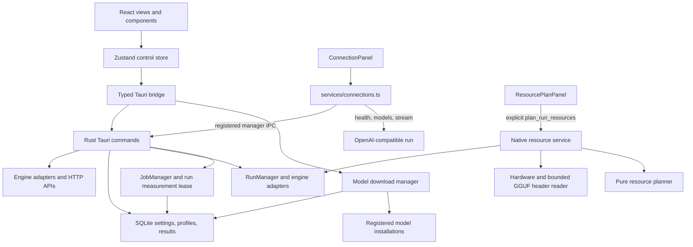

# Architecture

## Application layers

`App.tsx` initializes the store and routes screens. The [Zustand store](../../src/store/control.ts) holds drafts, current runtime state, and product actions. [tauri.ts](../../src/services/tauri.ts) wraps registered native commands and browser mocks.

The Contour shell, shared launch confirmation use case and pure memory presentation are documented in the [shell module](modules/shell.md). `npm run verify:modules` protects their boundaries together with existing pure domains; IPC and native resource ownership are preserved.

## API reference flow

The API page selects a current run target. It calls the registered `list_runs`, then `run_connection` for the selected `runId`. Only an explicit “command is not registered” error enables compatibility fallback on older backends. Network, database, and malformed-response errors are not converted to fallback.

Rust `fetch_openapi_spec` loads the OpenAPI reference: it validates the address, sends the Bearer key, and returns OpenAPI JSON or an engine reference bundled with the app. Health, model-list, and SSE checks use a separate frontend service with their own timeout and AbortSignal.

## Ownership and state

The supported local engine IDs are `llama_cpp` and `strata`. `ConnectionTarget.managed` describes whether the app owns a run, not whether its endpoint is healthy; readiness is checked separately from the run state (`ready`/`busy`). Chat, agents, and external API connectors do not depend on the local engine list.

The key stays in the selected target's memory and is sent in `Authorization: Bearer …` only on requests. The UI hides it; templates use an environment variable name. Key copying has its own explicit button. Keys are excluded from the connection-fields block and preview output.

## Run, job, and resource domains

The [run manager](modules/runs.md) owns per-run processes, immutable launch requests, generations, and port claims. [Engine adapters](modules/engine-adapters.md) prepare llama.cpp or Strata options. [Jobs](modules/jobs.md) obtain a run lease, reject competing lifecycle mutations during measurement, retain partial evidence on cancellation, and persist outcomes. [Profiles](modules/profiles.md) and the [artifact catalogue](modules/models.md) provide separate storage and filesystem domains. The [downloader](modules/model-downloads.md) owns queueing, resume, and file publication independently from those runs.

The [resource service](modules/resources.md#native-service) receives a preview launch request and copies active native requests before collecting current hardware. Its bounded GGUF header reader and pure planner produce advisory ranges and uncertainty. No resource variant is applied, and the standalone numeric lease registry is not wired into `start_run` admission. System-wide memory readings lack per-PID attribution; unverified active growth remains unknown.

An immutable settings request does not freeze referenced Strata configuration files, router presets, or weight contents. Those dependencies may change independently; fully reproducible launches require additional artifact/content capture.

[app_lifecycle.rs](../../src-tauri/src/app_lifecycle.rs) provides the shared Quit/window-close/ExitRequested path. Before shutdown, the download queue saves checkpoints, then lifecycle shuts down measurement jobs and owned runs. Cleanup failure retains a visible window and log for diagnosis/retry. Closing to tray keeps runs and background downloads active.

## Runtime evidence and remaining acceptance

Source and engine checks do not replace manual Windows acceptance with real models and GPUs. The current product supports two local engines; Strata configuration and weights remain user files. The downloader is checked separately for recovery, integrity, and atomic publication of complete GGUF sets.

Job IPC and isolated tests share `prepare_registration`/`run_registered_job`. Tests cover the full cancellation fixture and a real CPU job with queued/completed/persisted results. This verifies native core execution and persistence with optional AppHandle, while GUI events and Tauri IPC acceptance remain pending.
