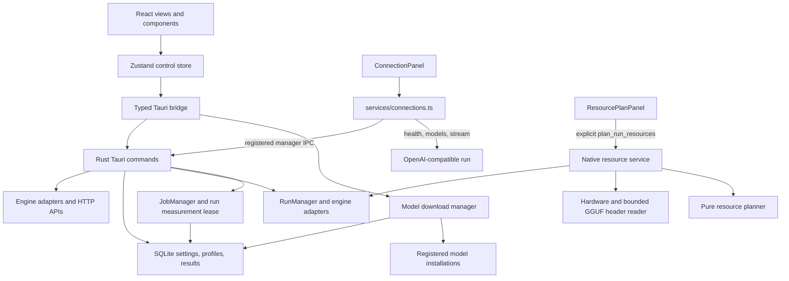

# Архитектура

## Слои приложения

`App.tsx` инициализирует store и управляет маршрутизацией экранов. [Zustand store](../../src/store/control.ts) хранит черновики, состояние текущего runtime и сценарии продукта. [tauri.ts](../../src/services/tauri.ts) оборачивает зарегистрированные native-команды и browser mock.

Оболочка «Контур», общий сценарий подтверждения запусков и чистая модель памяти описаны в [модуле оболочки](modules/shell.md). `npm run verify:modules` защищает их границы вместе с существующими чистыми доменами; IPC и native-владение ресурсами сохраняются.

## Поток API-справки

API-экран выбирает активный run target. Он вызывает зарегистрированную `list_runs`, затем `run_connection` для выбранного `runId`. Только явная ошибка «команда не зарегистрирована» включает режим совместимости со старым backend. Ошибки сети, БД и некорректных ответов не превращаются в fallback.

Загрузку OpenAPI выполняет Rust `fetch_openapi_spec`: команда проверяет адрес, передаёт Bearer-ключ и возвращает OpenAPI JSON или встроенную спецификацию движка. Проверки health, model list и SSE выполняются отдельным frontend-сервисом и имеют собственный тайм-аут и AbortSignal.

## Владение и состояние

Поддерживаемые локальные engine ID — `llama_cpp` и `strata`. `ConnectionTarget.managed` сообщает принадлежность запуска приложению, а не успешность endpoint; готовность проверяется отдельно по состоянию запуска (`ready`/`busy`). Чат, агенты и внешние API-коннекторы не зависят от списка локальных движков.

Ключ находится в памяти выбранного target и передаётся в `Authorization: Bearer …` только на запрос. В интерфейсе он скрыт; шаблоны используют имя переменной окружения. Копирование ключа вынесено в отдельную явную кнопку. Ключи не входят в connection-field block и не записываются в preview.

## Домены run, job и resources

[Run manager](modules/runs.md) владеет процессами отдельных запусков, immutable launch requests, generations и port claims. [Engine adapters](modules/engine-adapters.md) подготавливают параметры llama.cpp или Strata. [Jobs](modules/jobs.md) получают run lease, отклоняют конкурирующие lifecycle mutations во время измерения, сохраняют partial evidence при отмене и записывают outcome. [Profiles](modules/profiles.md) и [artifact catalogue](modules/models.md) предоставляют отдельные домены storage и filesystem. [Загрузчик](modules/model-downloads.md) владеет очередью, resume и публикацией файлов независимо от этих запусков.

[Resource service](modules/resources.md#native-service) получает preview launch request и копирует активные native requests перед опросом текущего hardware. Reader заголовка GGUF с ограничением размера и чистый planner возвращают advisory ranges и неопределённость. Resource variant не применяется; отдельный реестр числовых резервов не подключён к admission в `start_run`. System-wide memory readings не имеют per-PID attribution; непроверенный будущий рост активных запусков остаётся unknown.

Immutable settings request не фиксирует содержимое файлов конфигурации Strata, router presets или weights. Эти зависимости могут изменяться отдельно; полная воспроизводимость требует дополнительного сохранения artifacts/content.

[app_lifecycle.rs](../../src-tauri/src/app_lifecycle.rs) предоставляет общий путь Quit/window-close/ExitRequested. Перед закрытием очередь загрузок сохраняет контрольные точки, затем lifecycle завершает measurement jobs и owned runs. Ошибка cleanup сохраняет окно и журнал для диагностики/повтора. Закрытие в tray оставляет запуски и фоновые загрузки активными.

## Runtime evidence и оставшийся acceptance

Проверки исходников и движков не заменяют ручную Windows-приёмку на моделях и GPU. Текущий продукт поддерживает два локальных движка; конфигурация Strata и веса остаются пользовательскими файлами. Загрузчик проверяется отдельно на восстановление, целостность и атомарную публикацию полного GGUF-набора.

Job IPC и isolated tests используют общие `prepare_registration`/`run_registered_job`. Parent успешно выполнила полный cancellation fixture и реальную CPU queued/completed/persisted job; [native-job.json](../../artifacts/restructuring/native-job.json) содержит один measured sample и benchmark. Проверяется выполнение и persistence native core с optional AppHandle; GUI events и Tauri IPC acceptance ещё предстоят.
