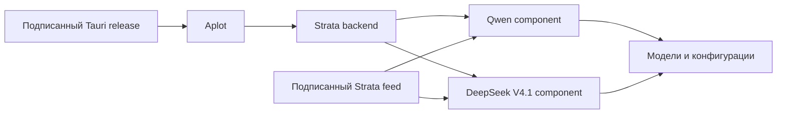

# Strata в Aplot: Qwen, DeepSeek и обновления движков

Дата: 26 октября 2026. Статус: интеграция реализована; установщик Aplot 0.9.1 собран, подписанный GitHub-релиз ожидает отдельной публикации.

## Архитектура

Aplot хранит Strata как один локальный backend. Внутри него семейство модели выбирает нужный runtime: **Qwen** или **DeepSeek**. Процессы, API, мониторинг и жизненный цикл остаются общими. Web UI Strata не запускается и не встраивается.

В установке Qwen размещается как компонент Strata в `components/engine`. DeepSeek устанавливается отдельно в `engine-dsv41`. Модели и их подготовленные конфигурации хранятся отдельно от кода Aplot. Каталог установщика закрепляет upstream Strata v0.2.6 и его Qwen пакет; подписанный feed Strata поставляет обновления Qwen и совместимые DeepSeek сборки.

## Обновление

В настройках доступны независимые команды обновления Qwen и DeepSeek. Они проверяют подпись upstream feed, совместимость пакета с компьютером, целостность файлов и не меняют версию Aplot. При запуске Strata или подготовке модели обновление движка блокируется. DeepSeek пакет загружается отдельно при подготовке модели или по команде обновления; неподдерживаемая GPU-сборка обозначается как недоступная.

Обновление оболочки Aplot остаётся отдельным Tauri updater: релиз требует подписанного артефакта и публикует `latest.json`. Его ключ и подпись приложения не заменяют ключ Strata, которым проверяются feed и движки.

## Текущая граница

- Закреплённая версия upstream — Strata `v0.2.6`: Qwen engine `0.1.50`, DeepSeek engine `0.1.51`.
- Установщик содержит совместимый базовый Qwen engine; DeepSeek engine не включён в установочный архив и загружается только при наличии совместимого пакета в подписанном feed.
- Смена бинарных пакетов движка выполняется без обновления оболочки. Изменение Rust/Tauri API-контракта всё ещё потребует нового релиза Aplot.
- Установщик и выпуск Aplot работают отдельно от feed Strata. Публикация новой версии Aplot не требуется для обычного обновления engine.

Источники: [Strata v0.2.6](https://github.com/Niko1221/Strata/releases/tag/v0.2.6), [исходники подписанного feed](https://github.com/Niko1221/Strata/tree/4b9e05a2a806a3fe24f7b2560d98626c37dade35/strata_control), [релизный updater Aplot](../.github/workflows/release.yml).
